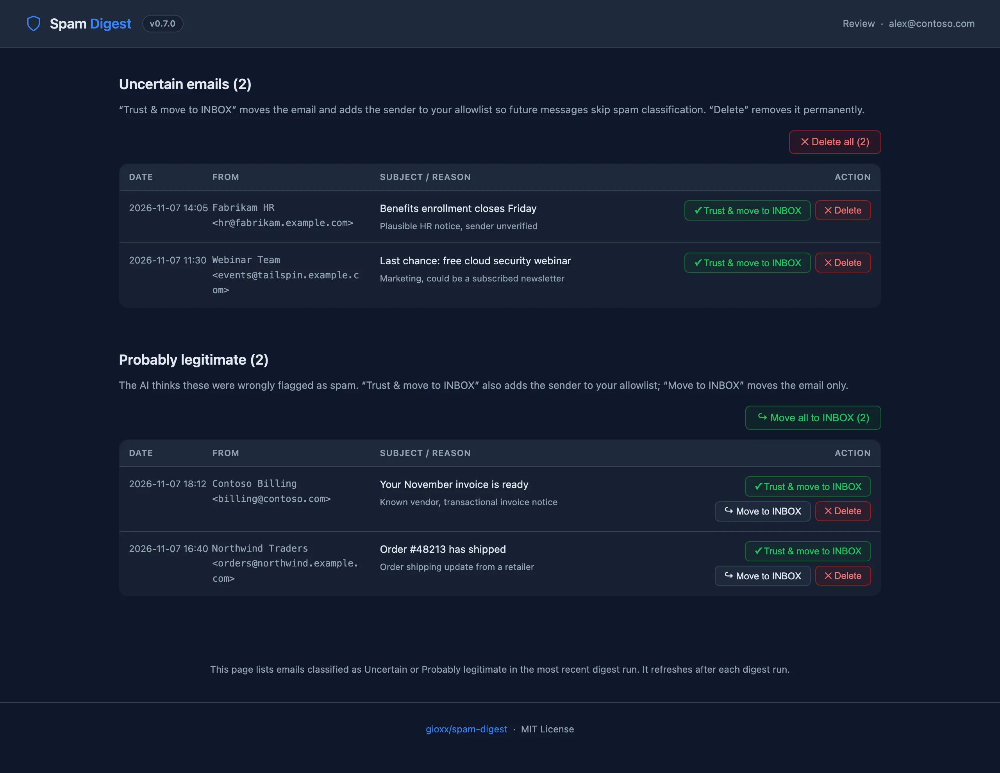

# 🛡 spam-digest

> Docker-based daily IMAP spam digest with optional Anthropic Claude AI triage.

spam-digest reads the spam folder of one or more IMAP mailboxes and emails you an HTML
digest of what landed there. An optional AI step labels each email **probably legitimate**,
**uncertain** or **spam** (only sender and subject are sent), and signed links in the digest
let you rescue, trust or delete emails from a web page.

**Website:** [spamdigest.gioxx.org](https://spamdigest.gioxx.org) · **Documentation:** [kb.gioxx.org/Projects/spam-digest](https://kb.gioxx.org/Projects/spam-digest)

[](https://github.com/gioxx/spam-digest/issues)
[](https://github.com/gioxx/spam-digest/pulls)
[](https://github.com/gioxx/spam-digest/blob/main/LICENSE)
[](https://github.com/users/gioxx/packages/container/package/spam-digest)
[](https://hub.docker.com/r/gfsolone/spam-digest)
[](https://hub.docker.com/r/gfsolone/spam-digest)



---

## Features

- **Daily digest email** per mailbox, on a cron schedule; no email when the spam folder is empty (configurable)
- **Multi-mailbox**, with automatic detection of common spam folder names
- **AI triage (optional)** with Anthropic Claude: sender and subject only, never the body
- **Review page**: move to INBOX (optionally trusting the sender) or delete, one by one or in bulk
- **Blocklist and allowlist rules** by sender, domain or subject, applied at every run
- **Delete confirmed spam** with one button, after a confirmation page
- **Status dashboard** on port 8080 with Run buttons
- **SMTP or Resend** delivery, pure Python standard library, no dependencies

---

## Quick start

```yaml
services:
  spam-digest:
    image: ghcr.io/gioxx/spam-digest:latest
    container_name: spam-digest
    restart: unless-stopped
    ports:
      - "8080:8080"
    volumes:
      - spam_digest_data:/data
    environment:
      TZ: Europe/Rome
      IMAP_SERVER: imap.example.com
      EMAIL_USER: you@example.com
      EMAIL_PASS: your-imap-password
      SMTP_HOST: smtp.example.com
      SMTP_USER: you@example.com
      SMTP_PASS: your-smtp-password
      # Optional: AI triage and the review/filters/delete links
      # AI_PROVIDER: anthropic
      # AI_API_KEY: sk-ant-...
      # WEB_BASE_URL: https://spamdigest.example.com

volumes:
  spam_digest_data:
```

```bash
docker compose up -d
```

The digest runs every day at 08:00 (`SCHEDULE_HOUR` / `SCHEDULE_MIN`, in the `TZ` timezone),
not at container start unless `RUN_ON_START=true`. The dashboard is at `http://localhost:8080`.
A complete [`docker-compose.yml`](docker-compose.yml) and an [`.env.example`](.env.example) are in this repository.

> [!WARNING]
> The dashboard has no login by default. Set `DASHBOARD_PASS` (and optionally `DASHBOARD_USER`, default `admin`) to protect it with HTTP Basic auth, and keep port 8080 on a trusted network or behind an HTTPS reverse proxy.

---

## Documentation

Everything else is on [kb.gioxx.org](https://kb.gioxx.org/Projects/spam-digest):

- [Environment variables](https://kb.gioxx.org/Projects/spam-digest#environment-variables) and [multi-mailbox mode](https://kb.gioxx.org/Projects/spam-digest#docker-compose-multi-mailbox)
- [Email delivery](https://kb.gioxx.org/Projects/spam-digest#email-delivery) (SMTP or Resend)
- [AI classification](https://kb.gioxx.org/Projects/spam-digest#ai-classification)
- [Web pages and links](https://kb.gioxx.org/Projects/spam-digest#web-pages-and-links): review, filters, delete
- [Dashboard](https://kb.gioxx.org/Projects/spam-digest#dashboard) and [CLI](https://kb.gioxx.org/Projects/spam-digest#cli) (`--dry-run`, `--force-send`, `--only`)
- [Troubleshooting](https://kb.gioxx.org/Projects/spam-digest#troubleshooting)

---

## Building locally

```bash
git clone https://github.com/gioxx/spam-digest.git
cd spam-digest
cp .env.example .env    # then edit .env
docker build -t spam-digest .
docker run -d --env-file .env -p 8080:8080 -v spam_digest_data:/data spam-digest
```

The project website lives in [`docs/`](docs/) and is published with GitHub Pages.

---

## License

MIT — see [LICENSE](LICENSE).

## Related projects

- [Clean Mail Automation](https://kb.gioxx.org/Projects/clean-mail-automation) ([repository](https://github.com/gioxx/clean-mail-automation)): automatically delete old emails from IMAP folders
